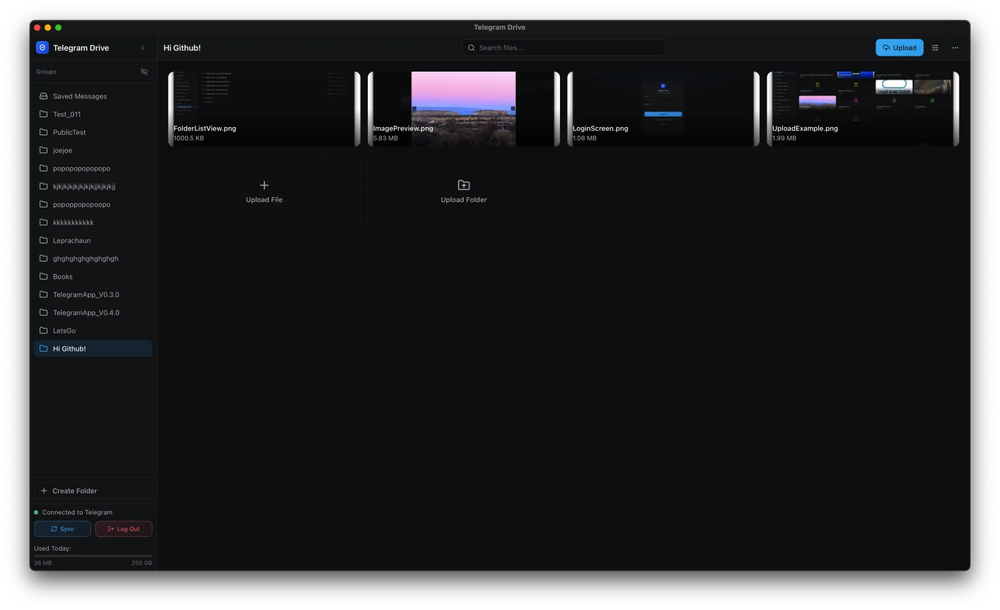
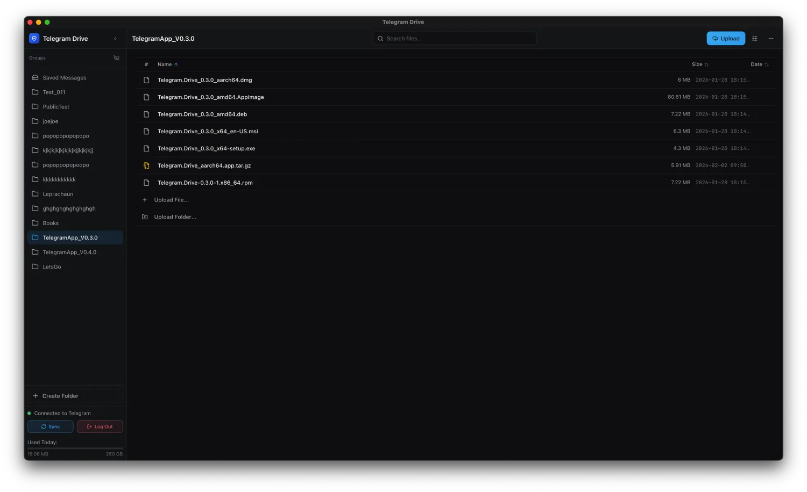
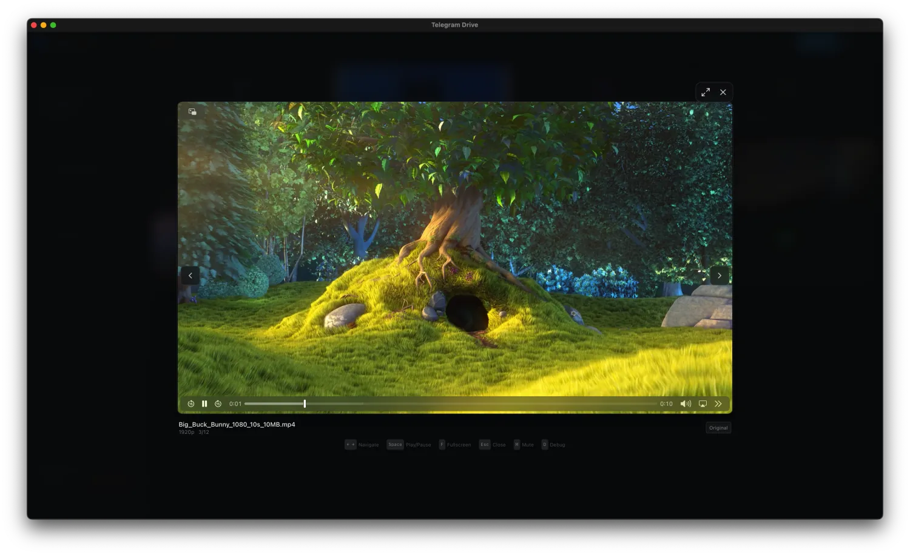
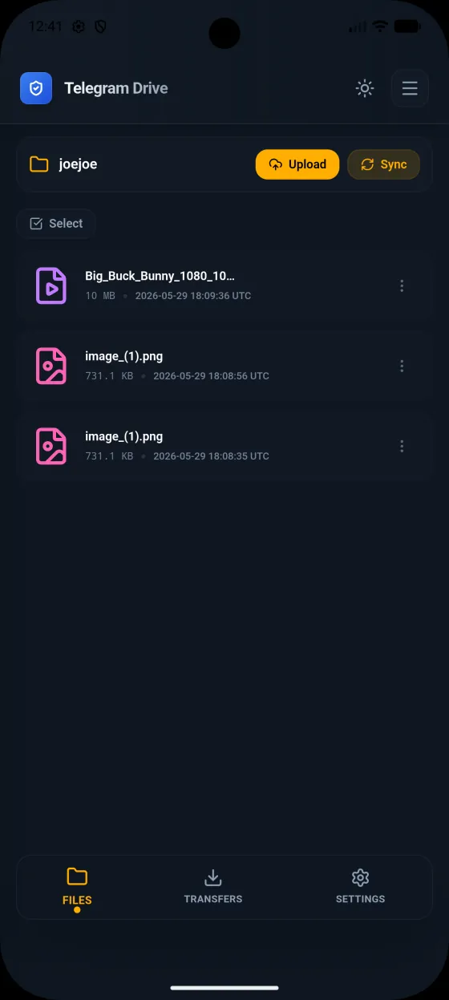
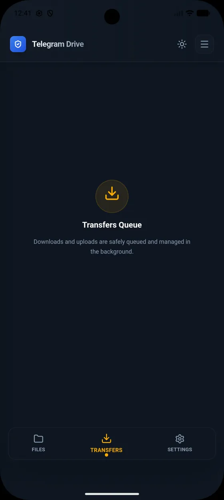

# Telegram Drive

### A local-first file workspace powered by your own Telegram account

Organize, transfer, preview, stream, sync, and share the files you keep in Saved Messages and Telegram channels—on Windows and Android.

[Releases](https://github.com/jakariatanjim-svg/Telegram-Drive/releases/latest) · [Issues](https://github.com/jakariatanjim-svg/Telegram-Drive/issues)

Telegram Drive turns Telegram's file storage into a focused, desktop-style workspace. The app connects directly to Telegram with credentials you provide; it does not run a separate file-storage or relay service. Every application feature is free and available without ads, paywalls, or subscriptions.

> [!IMPORTANT]
> Telegram Drive is an independent project and is not affiliated with Telegram FZ-LLC. Files remain subject to Telegram's account, service, and per-file limits. Telegram Drive should not be treated as literally unlimited storage or as the only backup of important data.

## Contents

- [At a glance](#at-a-glance)
- [Download and install](#download-and-install)
- [First-time setup](#first-time-setup)
- [How it works](#how-it-works)
- [Features](#features)
- [Screenshots](#screenshots)
- [Folder Sync](#folder-sync-desktop)
- [Optional client-side encryption](#optional-client-side-encryption-beta-format-frozen)
- [Privacy and security](#privacy-and-security)
- [Languages](#languages)
- [Android](#android)
- [Local REST API and WebDAV](#local-rest-api-and-webdav)
- [Support](#support)

## At a glance

| | |
| --- | --- |
| **Platforms** | Windows (Portable Installer) and Android (Mobile APK) |
| **Storage model** | Saved Messages is the home location; Telegram channels can be presented as folders |
| **Transfers** | Files, folders, drag and drop, remote URLs, durable queues, background operation, and retry controls |
| **Media** | Image preview, PDF viewing, audio playback, video streaming, thumbnails, and archive tools |
| **Desktop integrations** | Folder Sync, local REST API, WebDAV, local share links, tray controls, and native notifications |
| **Privacy** | Local configuration and caches, zero telemetry or analytics, loopback-only local servers, and no separate file relay |
| **Languages** | 24 selectable locales plus automatic system-language selection |
| **Price** | Free and open source |

## Download and install

Download official installers and Android packages from the [GitHub Releases](https://github.com/jakariatanjim-svg/Telegram-Drive/releases/latest) page.

- **Windows:** Download the portable installer from the latest release and select your preferred destination folder.
- **Android:** Download the signed mobile APK from the latest release, allow installing apps from your browser or file manager if prompted, and install over any previous build signed with the same key to preserve local data.

## First-time setup

Telegram requires third-party clients to use an application API ID and API hash. Telegram Drive does not provide shared credentials.

1. Sign in at [my.telegram.org](https://my.telegram.org) and open **API development tools**.
2. Create a Telegram application and copy its `api_id` and `api_hash`.
3. Install and open Telegram Drive, then enter those credentials locally.
4. Authenticate with your phone number and login code, or use QR login. If Telegram cloud-password protection is enabled, complete that step as well.
5. Open **Saved Messages** or select/create Telegram channels to use as folders.

> [!WARNING]
> Treat the API hash, Telegram login codes, session data, encryption credentials, REST keys, and WebDAV links as secrets. Do not paste them into issues, logs, screenshots, or support messages.

## How it works

Telegram Drive uses Telegram's MTProto API for authentication and file operations:

- **Saved Messages** appears as the main personal storage location.
- Telegram **channels** created or selected by the app can appear as folders.
- Transfers move directly between the application and Telegram.
- Metadata, settings, queues, sync state, thumbnails, and preview caches stay on the local device.
- Standard uploads are stored in Telegram in their normal form. Optional TDENC2 uploads are encrypted locally before transfer.

The application caps a Telegram object at **2,000,000,000 bytes**. Encrypted files need additional envelope space, so their maximum original plaintext size is slightly lower.

## Features

### File management and organization

- Grid and list views with virtualized rendering for large folders.
- Adjustable file-card sizing from **50% to 200%**.
- Filename search, persistent sorting, multi-select, range selection, and bulk actions.
- Upload, download, rename, copy, move, and delete workflows where Telegram permits them.
- Drag-and-drop uploads and internal drag-and-drop organization.
- Folder creation, rename, deletion, visibility controls, and custom local folder groups.
- Whole-folder uploads with optional ZIP creation before transfer.
- Remote URL uploads with progress, cancellation, retries, redirects, bounded size checks, and resumable ranges when supported by the source server.
- Duplicate-file, empty-folder, media-metadata, and storage-insight tools.

### Reliable transfers and desktop operation

- Durable upload and download queues that recover across window and application restarts.
- Independent upload/download concurrency controls, bandwidth controls, pause, resume, retry, cancel, cooldown, network-waiting, and vault-unlock states.
- Background operation from the system tray while transfers are active.
- Native transfer notifications for completion, failure, pause, and attention-required states, with per-category controls.
- Suspend, resume, network-recovery, and Telegram flood-wait handling.
- Verified downloads written through private temporary files and atomically published to their destination.
- A versioned local desktop file inventory so previously scanned folders appear while Telegram reconciliation continues.

### Viewing, playback, and archives

- Lazy-loaded thumbnails and bounded memory/disk preview caches.
- Desktop HEIC/HEIF still images use bounded JPEG display renditions in previews, gallery/slideshow, and offline viewing when supported by system codecs or FFmpeg; external opening and downloads keep the original file.
- A desktop image viewer with zoom, pan, fit-to-window, actual-size, wheel, double-click, and keyboard navigation controls.
- Built-in PDF viewer and audio player.
- Video playback with seeking, HLS/fMP4 streaming, remuxing/transcoding fallbacks, and cache recovery for supported plaintext media.
- Desktop MP4/M4V/MOV uploads in Media mode attach a locally generated JPEG preview and video dimensions/duration.
- Native Android playback with system media controls, resume, subtitle/audio-track selection, playback speed, and Picture-in-Picture where supported.
- ZIP, RAR, and 7z archive browsing and extraction, including extraction back into Telegram Drive where supported.
- Offline preview-cache controls for recently viewed standard files.

### Sharing and local integrations

- Password-protected local download links with optional expiration, listing, and revocation.
- Native Telegram message links for files in public channels.
- An opt-in desktop REST API for programmatic file, folder, bulk, storage, thumbnail, and media operations.
- Opt-in desktop WebDAV access for mounting Telegram Drive in compatible file managers.
- Optional, passphrase-encrypted settings backup through the user's own Telegram Saved Messages. Credentials, API/WebDAV keys, proxy details, and file data are excluded.

> [!NOTE]
> REST, WebDAV, and Telegram Drive share links are served by the running desktop application. They are not hosted public internet links. Keep the app open, do not forward its local ports, and protect every generated password, key, and capability URL.

### Personalization, language, and network controls

- System, light, dark, and default appearance preferences.
- Built-in theme presets and a custom-theme editor.
- Reduced-motion and interface-performance preferences.
- 24 selectable locales with locale-aware dates, numbers, file sizes, and transfer rates.
- Right-to-left document direction and bidirectional-text protections for Arabic, Persian, and Urdu.
- SOCKS5 and HTTP/HTTPS proxy routing with proxy credentials stored securely.
- Configurable VPN-oriented timeouts, retries, keep-alive behavior, polling, bandwidth, transfer chunk size, and archive limits.
- Android share-sheet intake, foreground transfers, and native downloaded-file publication.

## Screenshots

Screenshots show representative workflows; small details may change between releases.

### Desktop

| Folder and list management | Video playback |
| --- | --- |
|  |  |

### Android

| Files | Transfer queue |
| --- | --- |
|  |  |

Additional desktop and mobile captures are available in the [`screenshots`](screenshots/) directory.

## Folder Sync (desktop)

Folder Sync is an opt-in, bidirectional mapping between a local directory and one Telegram channel on desktop. It compares three states—the current local tree, the current remote tree, and the last successfully synced tree—before changing either side.

Safety behavior includes:

- Explicit conflicts instead of silent overwrites when local and remote versions both change.
- **Keep Local**, **Keep Remote**, and **Keep Both** conflict choices.
- A greater-than-50% mass-deletion guard.
- Atomic temporary-file downloads and exact transfer-size checks.
- Protection against nested mappings, duplicate remote paths, reserved temporary names, incomplete remote scans, and platform-incompatible filenames.
- Vault-aware queue pauses for encrypted mappings.
- A 50,000 file-bearing-message safety ceiling per mapped channel.

Folder Sync is disabled until enabled in **Settings → Folder Sync**. Keep a separate tested backup before mapping an important directory.

## Optional client-side encryption (beta, format frozen)

Telegram Drive includes opt-in encrypted transfers using the versioned **TDENC2** envelope. Standard uploads remain the default. Encryption can be selected as a default for future uploads or chosen for an individual upload.

| Mode | Protection | Required to unlock |
| --- | --- | --- |
| **Standard** | Existing plaintext Telegram upload | Nothing |
| **Vault** | Encrypts with a key held in the local encrypted vault | Unlocked vault |
| **File passphrase** | Adds a passphrase slot to the individual file | File passphrase |
| **Vault + file passphrase** | Adds both vault and per-file passphrase access | Any supported valid slot |

The implementation provides streaming XChaCha20-Poly1305 encryption before upload, authenticated streaming downloads, optional protection of the original filename and MIME type, vault auto-lock controls, recovery-bundle export/import, per-file state badges, and encryption-aware transfer queues.

> [!CAUTION]
> **Telegram Drive cannot recover, reset, or reconstruct a lost vault passphrase, file passphrase, encryption key, or unusable recovery bundle.** Protect and test your recovery material and keep an independent backup of important files. Lost credentials or damaged recovery material can make encrypted data permanently unrecoverable.

### Current encrypted-file limitations

The following operations fail closed for encrypted objects while retaining their normal behavior for standard files:

- In-app encrypted image and archive previews.
- Encrypted thumbnails, HLS/fMP4 remuxing, and transcoding.
- Local plaintext share links and REST/local-server plaintext access.
- WebDAV read, overwrite, rename, move, copy, and delete operations.
- Remote rename of encrypted Telegram media.
- Plaintext-to-encrypted migration, decrypt-in-place migration, rekey/slot-management UI, and full format migration.

TDENC2-protected audio, video, and PDF content can stream in supported in-app viewers while the vault is unlocked. The session-scoped credential is revoked when the vault locks, and the app does not publish a persistent plaintext copy. Download and authenticate other encrypted files before opening them in another application.

## Privacy and security

- The Telegram API ID and application state are stored locally, with sensitive secrets protected independently.
- Telegram session data, settings, transfer state, sync metadata, encryption registry data, and vault material stay on your device.
- Standard uploads send ordinary file content to Telegram. TDENC2 uploads send ciphertext, although Telegram can still observe transport/account metadata such as ciphertext size, time, account, and destination channel.
- The project does not operate a separate file-relay service and sends zero telemetry, analytics, or crash reports.
- The REST API and WebDAV server are disabled by default and bind only to `127.0.0.1`.
- The REST API stores only a hash of its generated key; the plaintext key is shown once.
- WebDAV capability links are shown once and can be revoked by regeneration.

## Languages

Telegram Drive supports a **System** language preference and these 24 selectable locales:

| | | | |
| --- | --- | --- | --- |
| English | Spanish | Russian | Ukrainian |
| Polish | Persian | Urdu | Malay |
| Simplified Chinese | Traditional Chinese | French | Italian |
| Arabic | Brazilian Portuguese | German | Hindi |
| Bengali (Bangladesh) | Indonesian | Filipino (Philippines) | Turkish |
| Thai (Thailand) | Japanese | Korean | Vietnamese |

## Android

The Android package is distributed as a signed mobile APK on GitHub Releases:

1. Open the [latest release](https://github.com/jakariatanjim-svg/Telegram-Drive/releases/latest) and download the APK.
2. On Android, allow **Install unknown apps** for the browser or file manager you used.
3. Open the APK and choose **Install**.
4. Enter your own Telegram API ID and API hash on first launch.

Android requirements and notes:

- Android 7.0 (API 24) or newer.
- Future updates signed with the same release key install cleanly over existing builds while preserving local data.

## Local REST API and WebDAV

Both integrations are desktop-only, disabled by default, and loopback-only.

| Integration | Default address | Authentication | Access |
| --- | --- | --- | --- |
| **REST API** | `http://127.0.0.1:8550/api/v1` | `X-API-Key` header | File/folder operations, bulk actions, storage data, thumbnails, and media metadata |
| **WebDAV** | `http://127.0.0.1:8551/dav/<private-token>/` | One-time capability URL | Read-only by default; writes require explicit opt-in |

To connect a WebDAV client, open **Settings → WebDAV**, generate a capability URL, copy it immediately, enable the server, and mount `http://127.0.0.1:8551/dav/<private-token>/` in your file manager. Do not expose local REST or WebDAV ports to a LAN or the internet.

## Support

- Report reproducible, non-sensitive problems through [GitHub Issues](https://github.com/jakariatanjim-svg/Telegram-Drive/issues).
- Never include Telegram credentials, session data, encryption keys, private filenames, or file contents in a public report.

---

Telegram Drive is not affiliated with Telegram FZ-LLC. Use the application responsibly and in accordance with Telegram's terms and applicable law.

